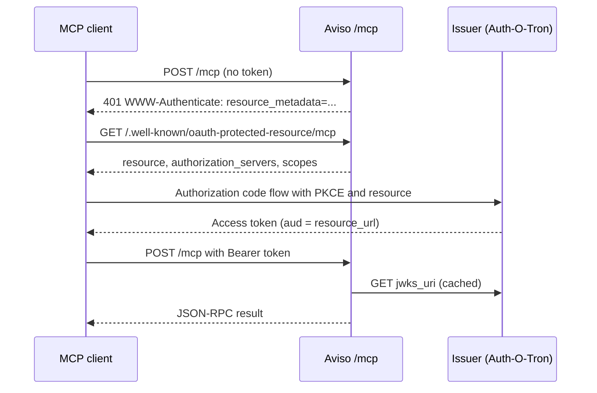

# MCP Endpoint

Aviso can serve a [Model Context Protocol](https://modelcontextprotocol.io)
endpoint at `/mcp`. MCP clients such as Claude Code, MCP Inspector, VS Code,
and Cursor can then read Aviso schemas and notification history through a
small set of read-only tools.

The endpoint is off by default. When it is off, no route is mounted and no
key set is fetched.

## What It Offers

The endpoint is read-only. It cannot publish, delete, or wipe anything.

| Tool | What it returns |
| --- | --- |
| `aviso_health` | Whether the notification backend is reachable. |
| `aviso_list_event_types` | Event types the caller may read. |
| `aviso_describe_event_type` | Same document as `GET /api/v1/schema/{event_type}`. |
| `aviso_replay_notifications` | Past notifications matching an identifier. |
| `aviso_check_data_available` | Whether a match is still held, and the oldest one. |

Every tool declares an input schema and an output schema. Results come back as
`structuredContent` with a JSON text copy in `content`, so older clients that
ignore structured output still see the data.

A field that can be `null`, such as `first_seen`, is written as `anyOf` with a
`{"type": "null"}` branch, not as a `type` array. Some clients accept only one
`type` per schema and would reject the tool otherwise.

Bad arguments, unknown event types, and denied streams come back as tool
results with `isError: true`. The model sees the reason and can try again.
Only an unknown tool name or a malformed call is a JSON-RPC error.

### Replay behaviour

`aviso_replay_notifications` uses the same validation and filtering as
`POST /api/v1/replay`:

- `identifier` follows the event type schema. Omitted optional fields match
  any value; constraint objects such as `{"gte": 0}` work as in REST.
- Without `from_date` or `from_id`, the last 24 hours are searched.
- Results are oldest first. `truncated` is `true` when more matches exist past
  the limit.
- `max_results` is capped by `mcp.max_results` (at most 200) and by the
  stream's own replay limit.
- Each call has a deadline of `mcp.request_timeout_ms`.

`aviso_check_data_available` searches the whole retained history unless
`from_date` is given, and returns the oldest match as `notification` with its
CloudEvent `time` as `first_seen`.

## Who Can Read What

MCP callers authenticate with OAuth access tokens, not with Aviso's REST
credentials. A verified token becomes an Aviso user with a username, a realm,
and roles. The username is always a short hash of the token `sub`, the same
value the debug logs show as the subject. The raw `sub` is never kept.

Where the realm and roles come from is set by `mcp.identity.source`:

| Source | Realm | Roles | Admins |
| --- | --- | --- | --- |
| `fixed` (default) | `identity.realm`, the same for every user | optional `roles` claim | nobody |
| `token_claims` | the token's realm claim | the token's roles claim | as in `auth.admin_roles` with `admin: true`, else nobody |

### Fixed realm

With `source: fixed`, every MCP user gets the same realm, `mcp` unless
`identity.realm` says otherwise. Roles come from the token's `roles` claim when
it has one; a missing or `null` claim means no roles. Nobody is an admin. To
open a stream to MCP users who hold the `aviso-mcp` role:

```yaml
notification_schema:
  data:
    auth:
      required: true
      read_roles:
        mcp: ["aviso-mcp"]
```

This source cannot tell users apart: any token with the role reads the
stream, whoever its user is.

### Realm and roles from token claims

With `source: token_claims`, the issuer writes the user's own realm and roles
into each access token. An MCP user then reads the streams the same user could
read through the REST API, with the exceptions listed under
[Differences from REST](#differences-from-rest).

```yaml
mcp:
  identity:
    source: token_claims
    realm_claim: "realm"   # default
    roles_claim: "roles"   # default
    admin: false           # default
```

Every token must carry both claims:

- `realm`: a string, the issuer realm the user signed in through, such as
  `ecmwf` or `browser-demo`. It is 1 to 128 characters of `A-Z`, `a-z`,
  `0-9`, `.`, `_`, or `-`. Realms are compared exactly, so `ECMWF` is not
  `ecmwf`.
- `roles`: an array of strings, possibly empty. It has at most 256 entries;
  each is 1 to 128 characters without surrounding whitespace or control
  characters.

A token payload then looks like this:

```json
{
  "iss": "https://auth.example.int/",
  "sub": "c0ffee42",
  "aud": "https://aviso.example.int/mcp",
  "iat": 1760000000,
  "exp": 1760003600,
  "jti": "5f1d6a",
  "client_id": "claude-code",
  "scope": "aviso:read",
  "realm": "ecmwf",
  "roles": ["reader", "analyst"]
}
```

`realm_claim` and `roles_claim` name top-level keys of the token payload,
taken literally. A dot is part of the name, not a path:
`roles_claim: "realm_access.roles"` looks for a key with that exact name and
does not read the `roles` field inside a `realm_access` object. An issuer
that nests roles, as Keycloak does, needs a mapper that copies them into a
top-level claim.

There is no fallback realm. A token that lacks either claim, sets one to
`null`, or has a claim of the wrong type or outside the limits above, is
refused with `401` and `error="invalid_token"`. The `error_description`
names the configured claim and the problem, without repeating the claim's
value, for example:

```text
token identity claims are invalid: realm claim 'realm' and roles claim 'roles' are missing
```

Auth-O-Tron writes these claims only for OAuth resources that enable
`identity_claims` in their `oauth.resources[]` entry. With it, the token
carries `realm`, and `roles` holds the user's roles filtered by the resource's
exposed-role list, so `read_roles` can only match roles on that list. See the
Auth-O-Tron OAuth documentation for the role list. Without `identity_claims`,
Auth-O-Tron tokens carry no `realm` claim, and their `roles` claim holds only
the roles the granted scopes require, so `token_claims` refuses them. Enable it
for the Aviso resource before switching to `token_claims`.

Before switching, also check the REST role maps. With `token_claims`, startup
fails if a key of `auth.admin_roles`, or of any stream's `read_roles` or
`write_roles`, is a realm no token can carry, such as `ECMWF staff`. It also
fails if a role in `read_roles` or `write_roles`, or in `auth.admin_roles` when
`admin` is `true`, is a role no token can carry, such as one longer than 128
characters. A rule written with such a realm or role would hold over REST and
never over MCP. The error names the first such realm or role and where it is
configured.

### Security

With `token_claims`, Aviso trusts the MCP issuer to name the realm and roles
of every user, for every realm the REST configuration knows. With
`admin: true` that trust extends to the admin realms in `auth.admin_roles`:
a token that names an admin realm and role reads every stream.

- The MCP issuer must be the authority the REST API already trusts for those
  realms and roles, normally the same Auth-O-Tron.
- Users must not be able to change their own realm or roles claims, for
  example through a profile attribute that a claim mapper copies into the
  token.
- Leave `admin` off unless MCP users really need admin reads. Admins skip
  every read rule.

### How read rules apply

Stream access follows the same rules as REST `watch` and `replay`, with the
user's realm and roles:

- A stream with no `auth` block, or with `required: false`, is readable by
  every MCP user.
- A stream with `required: true` and no `read_roles` is readable by every MCP
  user.
- With `read_roles`, the user's realm must be a key of the map, and the user
  must hold one of the roles listed for it. `["*"]` admits every user of that
  realm, even with no roles. A role named `*` in a token has no special
  meaning.
- With `token_claims` and `admin: true`, users that match `auth.admin_roles`
  read every stream. An empty `auth.admin_roles` makes nobody an admin. With
  `admin: false` or `source: fixed`, nobody is an admin over MCP.
- Streams that need an auth plugin (for example `ecpds`) are readable only by
  admins. The plugin check needs a REST request, so MCP cannot run it; REST
  admins skip it too.
- Only event types in the notification schema are readable over MCP, even
  when `notification_schema_strict` is `false` and the REST API accepts
  others.

For example, with `token_claims` and this stream:

```yaml
notification_schema:
  ops_data:
    auth:
      required: true
      read_roles:
        ecmwf: ["reader"]
        browser-demo: ["*"]
```

a user of realm `ecmwf` with role `reader` may read `ops_data`, and one with
only `viewer` may not. Every user of `browser-demo` may read it. A user of
any other realm may not, unless they are an admin. REST gives these users the
same answers.

`aviso_list_event_types` lists only the streams the caller may read; the
others do not appear.

An event type the caller may not read gets the same tool error as one that
does not exist, from every tool:

```text
Event type '<name>' not found or not readable with this token;
aviso_list_event_types lists the readable ones
```

The message is one line. The tools never reveal which event types exist
beyond the ones the caller can read.

### Differences from REST

With `token_claims`, MCP and REST answer the same user the same way, except:

- Realms are limited to 1 to 128 characters of `A-Z`, `a-z`, `0-9`, `.`, `_`,
  or `-`. Startup refuses REST realms outside that set, as described above.
- A token with more than 256 roles, or with a role longer than 128 characters,
  padded with whitespace, or holding control characters, is refused as a
  whole. Roles are never dropped or shortened. REST has no such limits.
- REST admins are MCP admins only with `admin: true`.
- Streams with auth plugins are readable by admins only. REST runs the plugin
  check for other users instead.
- With `notification_schema_strict: false`, REST accepts event types that the
  schema does not list. MCP answers them as not found or not readable.
- With REST authentication off (`auth.enabled: false`), REST serves every
  stream without credentials. MCP still needs a valid token and still checks
  the stream rules. Startup refuses stream `auth` rules while REST
  authentication is off, so in practice the difference is the token.

## Configuration

```yaml
mcp:
  enabled: true
  resource_url: "https://aviso.example.int/mcp"
  allowed_origins: ["http://localhost:6274"]
  max_results: 100
  request_timeout_ms: 10000
  oauth:
    issuer: "https://auth.example.int/"
    jwks_uri: "https://auth.example.int/.well-known/jwks.json"
    required_scopes: ["aviso:read"]
    jwks_cache_ttl_seconds: 300
  identity:
    source: fixed
    realm: "mcp"
```

When `enabled` is `true`, startup fails unless:

- `resource_url`, `oauth.issuer`, and `oauth.jwks_uri` are absolute `https`
  URLs without query, fragment, or credentials.
- The path of `resource_url` is exactly `/mcp`.
- Each `allowed_origins` entry is a bare origin such as
  `https://app.example.int` (no trailing slash, no path).
- `max_results` is between 1 and 200, and the timeouts are above zero.
- An `identity` block names its `source`, `fixed` or `token_claims`, and holds
  only the fields of that source. Leaving out the whole block means
  `source: fixed` with realm `mcp`.
- With `fixed`, `identity.realm` is 1 to 128 characters of `A-Z`, `a-z`,
  `0-9`, `.`, `_`, or `-`.
- With `fixed`, `identity.realm` is not a key of `auth.admin_roles` or of any
  stream's `write_roles`. Those realms belong to REST users, and sharing one
  would let token roles match rules written for them. Naming the realm in
  `read_roles` is fine; that is how streams are opened to MCP users.
- With `token_claims`, `realm_claim` and `roles_claim` are 1 to 128
  characters without whitespace or control characters, and they differ. Neither
  may be a claim the verifier already checks: `iss`, `sub`, `aud`, `exp`,
  `nbf`, `iat`, `jti`, `client_id`, or `scope`. `admin` is `true` or `false`,
  written as a boolean or as the string `"true"` or `"false"`; values such as
  `yes` or `1` are refused.
- With `token_claims`, every key of `auth.admin_roles` and of each stream's
  `read_roles` and `write_roles` is a realm a token can carry: 1 to 128
  characters of `A-Z`, `a-z`, `0-9`, `.`, `_`, or `-`. Every role of
  `read_roles` and `write_roles`, and of `auth.admin_roles` when `admin` is
  `true`, is a role a token can carry: 1 to 128 characters without surrounding
  whitespace or control characters. The error names the first realm or role
  that is not, and where it is configured.

With `fixed`, every stream whose `read_roles` names the MCP realm is readable
by MCP tokens that carry a matching role, or any role when the list is
`["*"]`. Pick a dedicated realm name for MCP and use it for nothing else, so
that no stream opens to MCP clients by accident. With `token_claims` the
realms are the issuer's own, shared with REST on purpose, so this does not
apply.

`resource_url` must be the public URL clients use. Tokens must name it as
their audience, byte for byte. `oauth.issuer` is also compared byte for
byte, so keep any trailing slash the issuer uses.

The server mounts the endpoint at `/mcp` and its metadata at
`/.well-known/oauth-protected-resource/mcp`, at the root of the host. That is
why the path of `resource_url` must be `/mcp`: clients derive the metadata
URL from it as RFC 9728 describes. A reverse proxy must forward both paths
unchanged. Publishing the endpoint under a prefix such as
`https://example.int/aviso/mcp` is not supported.

Every field can be set from the environment, for example:

```bash
AVISOSERVER_MCP__ENABLED=true
AVISOSERVER_MCP__RESOURCE_URL=https://aviso.example.int/mcp
AVISOSERVER_MCP__OAUTH__ISSUER=https://auth.example.int/
AVISOSERVER_MCP__OAUTH__JWKS_URI=https://auth.example.int/.well-known/jwks.json
AVISOSERVER_MCP__IDENTITY__SOURCE=token_claims
AVISOSERVER_MCP__IDENTITY__ADMIN=false
```

The environment is merged into the configuration file field by field. To
switch the source from the environment, the file must not hold fields of the
other source. A file with `source: fixed` and `realm: "mcp"` plus
`AVISOSERVER_MCP__IDENTITY__SOURCE=token_claims` fails with
`` unknown field `realm` ``; leave `realm` out of the file, since `mcp` is its
default.

See the [configuration reference](./configuration-reference.md#mcp) for every
field.

## Authorization Flow

The endpoint is an OAuth protected resource. It never issues tokens itself.
Clients discover the issuer from the `401` challenge, run the authorization
code flow with PKCE against it, and come back with a token.



A token is accepted only when all of these hold:

- The header has `alg: RS256`, `typ: at+jwt`, and a `kid` found in the
  issuer's key set.
- `iss` equals `mcp.oauth.issuer`.
- `aud` is `mcp.resource_url`, or an array that contains it.
- `exp`, `nbf`, and `iat` are valid with 30 seconds of clock skew.
- `sub`, `jti`, and `client_id` are present and not empty, as RFC 9068
  requires.
- `scope` contains every entry of `mcp.oauth.required_scopes`.
- The identity claims are valid: with `token_claims`, both claims are present
  and within bounds; with `fixed`, a `roles` claim, if present, is.

The checks run in this order. Identity claims are read last, only once the
signature, the other claims, and the scope have passed. A token without the
required scope therefore gets `403` even when its identity claims are also
unusable, so the client asks for the scope rather than for a new token.

A missing token gets `401` with a challenge like this:

```text
WWW-Authenticate: Bearer resource_metadata="https://aviso.example.int/.well-known/oauth-protected-resource/mcp", scope="aviso:read"
```

An invalid token adds `error="invalid_token"` and an `error_description` that
names the failed check:

```text
WWW-Authenticate: Bearer error="invalid_token", error_description="token is invalid: wrong audience", resource_metadata="https://aviso.example.int/.well-known/oauth-protected-resource/mcp", scope="aviso:read"
```

The JSON body repeats both, as `error` and `error_description`. The
description never contains token content. A valid token without the required
scope gets `403` with `error="insufficient_scope"`. If the key set cannot be
fetched at all, the answer is `503`.

The key set is cached for `jwks_cache_ttl_seconds`. A token with an unknown
`kid` triggers an early refetch, at most once per minute, so key rotation is
picked up without letting forged tokens flood the issuer.

Once the TTL has passed, one request refreshes the key set while the others
keep using the cached keys, so a slow issuer does not stall verification. If
the issuer stays unreachable, the cached set is used for at most twelve TTLs,
and never less than one hour. After that, tokens get `503` until a fetch
succeeds, so an issuer outage cannot keep removed keys valid forever.

The metadata document is served at both
`/.well-known/oauth-protected-resource/mcp` and
`/.well-known/oauth-protected-resource`:

```json
{
  "resource": "https://aviso.example.int/mcp",
  "authorization_servers": ["https://auth.example.int/"],
  "scopes_supported": ["aviso:read"],
  "bearer_methods_supported": ["header"],
  "resource_name": "Aviso"
}
```

## Transport

The endpoint implements the stateless form of the MCP Streamable HTTP
transport:

- `POST /mcp` takes exactly one JSON-RPC message. A batch (a JSON array)
  gets `400` with JSON-RPC error `-32600`, whatever the protocol version.
- Requests get `200` with an `application/json` body. Notifications and
  responses get `202` with no body.
- `GET` and `DELETE` get `405`. There is no SSE stream and no session; the
  server never sends `Mcp-Session-Id`.
- `Accept` must include `application/json`. `text/event-stream` may be listed
  too but is never used.
- `MCP-Protocol-Version` may be `2025-11-25`, `2025-06-18`, or `2025-03-26`.
  A missing header means `2025-03-26`; anything else gets `400`.
- `initialize` echoes the client's version when supported and otherwise
  offers `2025-11-25`.
- Requests with an `Origin` header must come from `allowed_origins`, or they
  get `403`. Requests without `Origin`, as sent by desktop and CLI clients,
  are allowed.
- Bodies over 64 KiB get `413`.

Revision `2025-03-26` allowed clients to send batches, and later revisions
removed them. This server rejects batches under every revision, including
`2025-03-26`. Clients that follow that revision but never batch, which covers
the common SDKs, are unaffected.

The bearer token is checked before the body is read. Every unauthenticated
request gets the same `401` challenge, whatever it contains.

## Client Setup

Clients need a client registration at the issuer. With Auth-O-Tron, the
issuer operator registers each client id, its redirect URIs, and the Aviso
resource with the `aviso:read` scope. Then point the client at the public
`/mcp` URL:

```bash
# Claude Code
claude mcp add --transport http aviso https://aviso.example.int/mcp \
  --client-id claude-code --callback-port 53682
```

For MCP Inspector, choose the Streamable HTTP transport, enter the `/mcp`
URL, and set the client id under the OAuth settings. Browser-based clients
also need their origin in `allowed_origins`.

## Logs

At startup, `startup.mcp.enabled` records the resource URL, the issuer, the
identity source (`identity_source`), and whether REST admin roles apply to MCP
users (`identity_admin`).

Each request logs `mcp.request.completed` at info level with the JSON-RPC
method, the tool name, an outcome label, the HTTP status, and the duration.
Tokens, claims, and tool arguments are never logged. At debug level,
`mcp.request.subject` adds a short hash of the token subject so one client's
requests can be correlated.

Two warnings come from the replay tools. `mcp.tool.replay.failed` carries the
backend error behind a failed replay; the model only sees a generic message.
`mcp.tool.replay.render_failed` counts notifications a replay had to skip,
with the event type. It is logged only for configured event types the caller
could read.

## Limitations

- Tools are read-only. There is no publish tool and no live watch.
- Only RS256 tokens are accepted, and only from one issuer.
- The endpoint does not support dynamic client registration; clients must be
  registered at the issuer in advance.
- MCP users are admins only with `source: token_claims` and `admin: true`.
  Streams with auth plugins are readable only by such admins.
- With `token_claims`, realms and roles have the limits listed under
  [Differences from REST](#differences-from-rest).
- Replay results are capped at 200 notifications per call.

## Testing With the Python SDK

`tests/interop/mcp_python_client.py` drives the endpoint with the official
MCP Python SDK. It runs from an ignored test that starts a local server and a
local key set:

```bash
python3 -m venv /tmp/mcp-venv
/tmp/mcp-venv/bin/pip install mcp
MCP_INTEROP_PYTHON=/tmp/mcp-venv/bin/python \
  cargo test --locked --test mcp_transport -- --ignored
```
