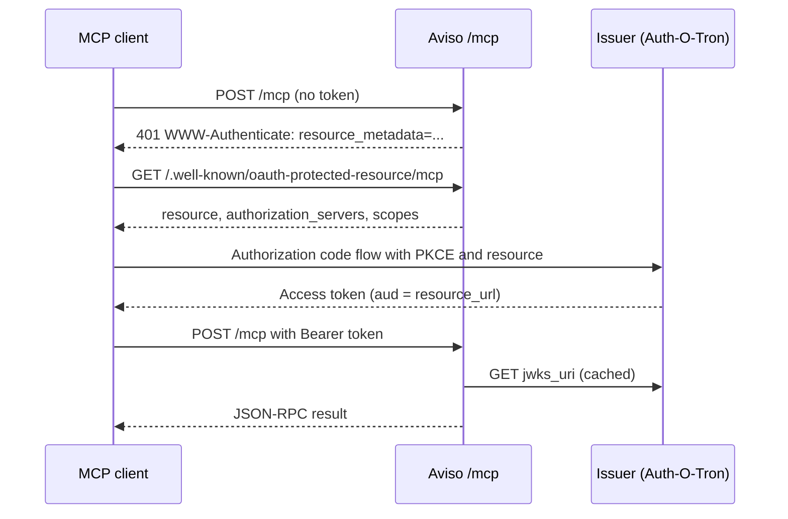

# MCP Endpoint

Aviso can serve a [Model Context Protocol](https://modelcontextprotocol.io)
endpoint at `/mcp`. MCP clients such as Claude Code, MCP Inspector, VS Code,
and Cursor can then read Aviso schemas and notification history through a
small set of read-only tools.

The endpoint is off by default. When it is off, no route is mounted and no
key set is fetched.

## What It Offers

The endpoint is read-only. It cannot publish, delete, or wipe anything.

| Tool | What it returns |
| --- | --- |
| `aviso_health` | Whether the notification backend is reachable. |
| `aviso_list_event_types` | Event types the caller may read. |
| `aviso_describe_event_type` | Same document as `GET /api/v1/schema/{event_type}`. |
| `aviso_replay_notifications` | Past notifications matching an identifier. |
| `aviso_check_data_available` | Whether a match is still held, and the oldest one. |

Every tool declares an input schema and an output schema. Results come back as
`structuredContent` with a JSON text copy in `content`, so older clients that
ignore structured output still see the data.

Bad arguments, unknown event types, and denied streams come back as tool
results with `isError: true`. The model sees the reason and can try again.
Only an unknown tool name or a malformed call is a JSON-RPC error.

### Replay behaviour

`aviso_replay_notifications` uses the same validation and filtering as
`POST /api/v1/replay`:

- `identifier` follows the event type schema. Omitted optional fields match
  any value; constraint objects such as `{"gte": 0}` work as in REST.
- Without `from_date` or `from_id`, the last 24 hours are searched.
- Results are oldest first. `truncated` is `true` when more matches exist past
  the limit.
- `max_results` is capped by `mcp.max_results` (at most 200) and by the
  stream's own replay limit.
- Each call has a deadline of `mcp.request_timeout_ms`.

`aviso_check_data_available` searches the whole retained history unless
`from_date` is given, and returns the oldest match as `notification` with its
CloudEvent `time` as `first_seen`.

## Who Can Read What

MCP callers authenticate with OAuth access tokens, not with Aviso's REST
credentials. A verified token becomes an Aviso user:

- `username` is a short hash of the token `sub`, the same value the debug
  logs show as the subject. The raw `sub` is never kept.
- `realm` is `mcp.identity.realm` (default `mcp`).
- `roles` are the token's `roles` claim (at most 64).

The user is never an admin, whatever its roles. Stream access then follows
the normal `read_roles` rules. To open a stream to MCP users who hold the
`aviso-mcp` role:

```yaml
notification_schema:
  data:
    auth:
      required: true
      read_roles:
        mcp: ["aviso-mcp"]
```

Streams with no `auth` block stay readable by any MCP user. Streams that need
an auth plugin (for example `ecpds`) are not readable over MCP and do not
appear in `aviso_list_event_types`.

An event type the caller may not read gets the same answer as one that does
not exist, `Event type '<name>' not found`, from every tool. The tools never
reveal which event types exist beyond the ones the caller can read.

## Configuration

```yaml
mcp:
  enabled: true
  resource_url: "https://aviso.example.int/mcp"
  allowed_origins: ["http://localhost:6274"]
  max_results: 100
  request_timeout_ms: 10000
  oauth:
    issuer: "https://auth.example.int/"
    jwks_uri: "https://auth.example.int/.well-known/jwks.json"
    required_scopes: ["aviso:read"]
    jwks_cache_ttl_seconds: 300
  identity:
    realm: "mcp"
```

When `enabled` is `true`, startup fails unless:

- `resource_url`, `oauth.issuer`, and `oauth.jwks_uri` are absolute `https`
  URLs without query, fragment, or credentials.
- The path of `resource_url` is exactly `/mcp`.
- Each `allowed_origins` entry is a bare origin such as
  `https://app.example.int` (no trailing slash, no path).
- `max_results` is between 1 and 200, and the timeouts are above zero.

`resource_url` must be the public URL clients use. Tokens must name it as
their audience, byte for byte. `oauth.issuer` is also compared byte for
byte, so keep any trailing slash the issuer uses.

Every field can be set from the environment, for example:

```bash
AVISOSERVER_MCP__ENABLED=true
AVISOSERVER_MCP__RESOURCE_URL=https://aviso.example.int/mcp
AVISOSERVER_MCP__OAUTH__ISSUER=https://auth.example.int/
AVISOSERVER_MCP__OAUTH__JWKS_URI=https://auth.example.int/.well-known/jwks.json
```

See the [configuration reference](./configuration-reference.md#mcp) for every
field.

## Authorization Flow

The endpoint is an OAuth protected resource. It never issues tokens itself.
Clients discover the issuer from the `401` challenge, run the authorization
code flow with PKCE against it, and come back with a token.



A token is accepted only when all of these hold:

- The header has `alg: RS256`, `typ: at+jwt`, and a `kid` found in the
  issuer's key set.
- `iss` equals `mcp.oauth.issuer`.
- `aud` is `mcp.resource_url`, or an array that contains it.
- `exp`, `nbf`, and `iat` are valid with 30 seconds of clock skew.
- `sub`, `jti`, and `client_id` are present and not empty, as RFC 9068
  requires.
- `scope` contains every entry of `mcp.oauth.required_scopes`.

A missing token gets `401` with a challenge like this:

```text
WWW-Authenticate: Bearer resource_metadata="https://aviso.example.int/.well-known/oauth-protected-resource/mcp", scope="aviso:read"
```

An invalid token adds `error="invalid_token"`. A valid token without the
required scope gets `403` with `error="insufficient_scope"`. If the key set
cannot be fetched at all, the answer is `503`.

The key set is cached for `jwks_cache_ttl_seconds`. A token with an unknown
`kid` triggers an early refetch, at most once per minute, so key rotation is
picked up without letting forged tokens flood the issuer.

Once the TTL has passed, one request refreshes the key set while the others
keep using the cached keys, so a slow issuer does not stall verification. If
the issuer stays unreachable, the cached set is used for at most twelve TTLs,
and never less than one hour. After that, tokens get `503` until a fetch
succeeds, so an issuer outage cannot keep removed keys valid forever.

The metadata document is served at both
`/.well-known/oauth-protected-resource/mcp` and
`/.well-known/oauth-protected-resource`:

```json
{
  "resource": "https://aviso.example.int/mcp",
  "authorization_servers": ["https://auth.example.int/"],
  "scopes_supported": ["aviso:read"],
  "bearer_methods_supported": ["header"],
  "resource_name": "Aviso"
}
```

## Transport

The endpoint implements the stateless form of the MCP Streamable HTTP
transport:

- `POST /mcp` takes exactly one JSON-RPC message. Batches are rejected.
- Requests get `200` with an `application/json` body. Notifications and
  responses get `202` with no body.
- `GET` and `DELETE` get `405`. There is no SSE stream and no session; the
  server never sends `Mcp-Session-Id`.
- `Accept` must include `application/json`. `text/event-stream` may be listed
  too but is never used.
- `MCP-Protocol-Version` may be `2025-11-25`, `2025-06-18`, or `2025-03-26`.
  A missing header means `2025-03-26`; anything else gets `400`.
- `initialize` echoes the client's version when supported and otherwise
  offers `2025-11-25`.
- Requests with an `Origin` header must come from `allowed_origins`, or they
  get `403`. Requests without `Origin`, as sent by desktop and CLI clients,
  are allowed.
- Bodies over 64 KiB get `413`.

The bearer token is checked before the body is read. Every unauthenticated
request gets the same `401` challenge, whatever it contains.

## Client Setup

Clients need a client registration at the issuer. With Auth-O-Tron, the
issuer operator registers each client id, its redirect URIs, and the Aviso
resource with the `aviso:read` scope. Then point the client at the public
`/mcp` URL:

```bash
# Claude Code
claude mcp add --transport http aviso https://aviso.example.int/mcp \
  --client-id claude-code --callback-port 53682
```

For MCP Inspector, choose the Streamable HTTP transport, enter the `/mcp`
URL, and set the client id under the OAuth settings. Browser-based clients
also need their origin in `allowed_origins`.

## Logs

Each request logs `mcp.request.completed` at info level with the JSON-RPC
method, the tool name, an outcome label, the HTTP status, and the duration.
Tokens, claims, and tool arguments are never logged. At debug level,
`mcp.request.subject` adds a short hash of the token subject so one client's
requests can be correlated.

## Limitations

- Tools are read-only. There is no publish tool and no live watch.
- Only RS256 tokens are accepted, and only from one issuer.
- The endpoint does not support dynamic client registration; clients must be
  registered at the issuer in advance.
- MCP users are never admins, and streams with auth plugins are not readable.
- Replay results are capped at 200 notifications per call.

## Testing With the Python SDK

`tests/interop/mcp_python_client.py` drives the endpoint with the official
MCP Python SDK. It runs from an ignored test that starts a local server and a
local key set:

```bash
python3 -m venv /tmp/mcp-venv
/tmp/mcp-venv/bin/pip install mcp
MCP_INTEROP_PYTHON=/tmp/mcp-venv/bin/python \
  cargo test --locked --test mcp_transport -- --ignored
```
